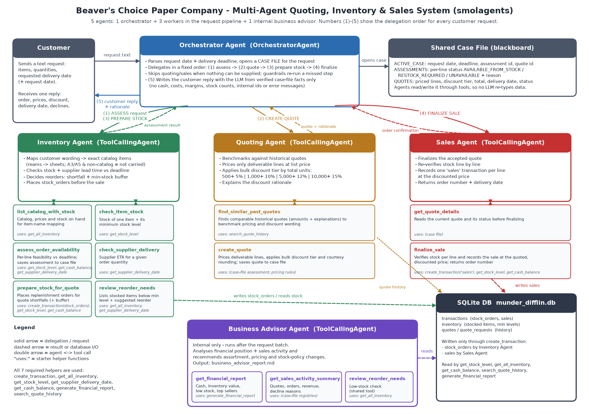

# Beaver's Choice Paper Company – Multi-Agent Inventory, Quoting & Sales System

A multi-agent system built with **[smolagents](https://github.com/huggingface/smolagents)**. It answers customer paper-supply requests end to end: it checks inventory and supplier lead times, restocks when needed, prices quotes with bulk discounts benchmarked against historical quotes, records sales in SQLite, and replies to the customer with a clear explanation. Items it cannot supply are declined, each with a reason.

| Deliverable | File |
|---|---|
| Workflow diagram | [`agent_workflow_diagram.png`](agent_workflow_diagram.png) |
| Implementation (single Python file) | [`project_starter.py`](project_starter.py) |
| Design and reflection report | [`REPORT.md`](REPORT.md) |
| Evaluation output | [`test_results.csv`](test_results.csv) |
| Business-advisor output (stand-out feature) | [`business_advisor_report.md`](business_advisor_report.md) |
| Full console log of the evaluation run | [`run_log.txt`](run_log.txt) |



## Agents (5 in total)

| Agent | Role | Tools → starter helper functions |
|---|---|---|
| **Orchestrator** (`OrchestratorAgent`) | Opens a case file per request, delegates in order (assess → quote → prepare stock → finalize), writes the customer reply | – |
| **Inventory Agent** | Maps customer wording to catalog items, checks stock and supplier lead times, decides on and places restock orders | `list_catalog_with_stock` → `get_all_inventory`; `check_item_stock` → `get_stock_level`; `check_supplier_delivery` → `get_supplier_delivery_date`; `assess_order_availability` → `get_stock_level`, `get_supplier_delivery_date`, `get_cash_balance`; `prepare_stock_for_quote` → `create_transaction`, `get_cash_balance`; `review_reorder_needs` → `get_all_inventory` |
| **Quoting Agent** | Benchmarks against past quotes, prices deliverable lines, applies bulk-discount tiers | `find_similar_past_quotes` → `search_quote_history`; `create_quote` |
| **Sales Agent** | Finalizes the quote and records sales transactions | `get_quote_details`; `finalize_sale` → `create_transaction`, `get_stock_level`, `get_cash_balance` |
| **Business Advisor** | Internal: reviews the finances after the run and recommends improvements | `get_financial_report` → `generate_financial_report`; `get_sales_activity_summary`; `review_reorder_needs` |

## Running it

```bash
python3.11 -m venv .venv && source .venv/bin/activate
pip install -r requirements.txt
# .env (never commit this file)
echo 'UDACITY_OPENAI_API_KEY=your_key_here' >  .env
echo 'OPENAI_BASE_URL=https://openai.vocareum.com/v1' >> .env
python project_starter.py
```

The run resets `munder_difflin.db` and processes the 20 requests in `quote_requests_sample.csv` in date order. It writes `test_results.csv` and `business_advisor_report.md`. The model defaults to `gpt-4.1-mini`; set `AGENT_MODEL_ID` to change it.
